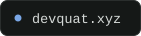
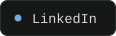
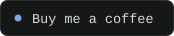

  
  
  
  
  

I like working on questions with consequences. What happens if a payment request arrives twice? Who can read a customer's data? How does the team know a worker has stopped?

## Engineering focus

<a href="https://devquat.xyz/projects">View all 13 projects →</a>

## Recently

- **Open source** — TypeScript migration for [Actual Budget](https://github.com/actualbudget/actual/pull/9348)'s sync-server CORS proxy, with regression tests
- **NASA Space Apps Challenge 2026** — Galactic Problem Solver certificate
- **Kodelift Initiative** — program coordinator & instructor, mentoring young developers

## Toolbox

## GitHub activity

  
  
  
  

