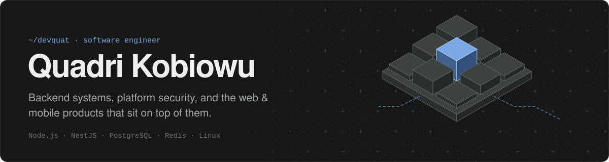
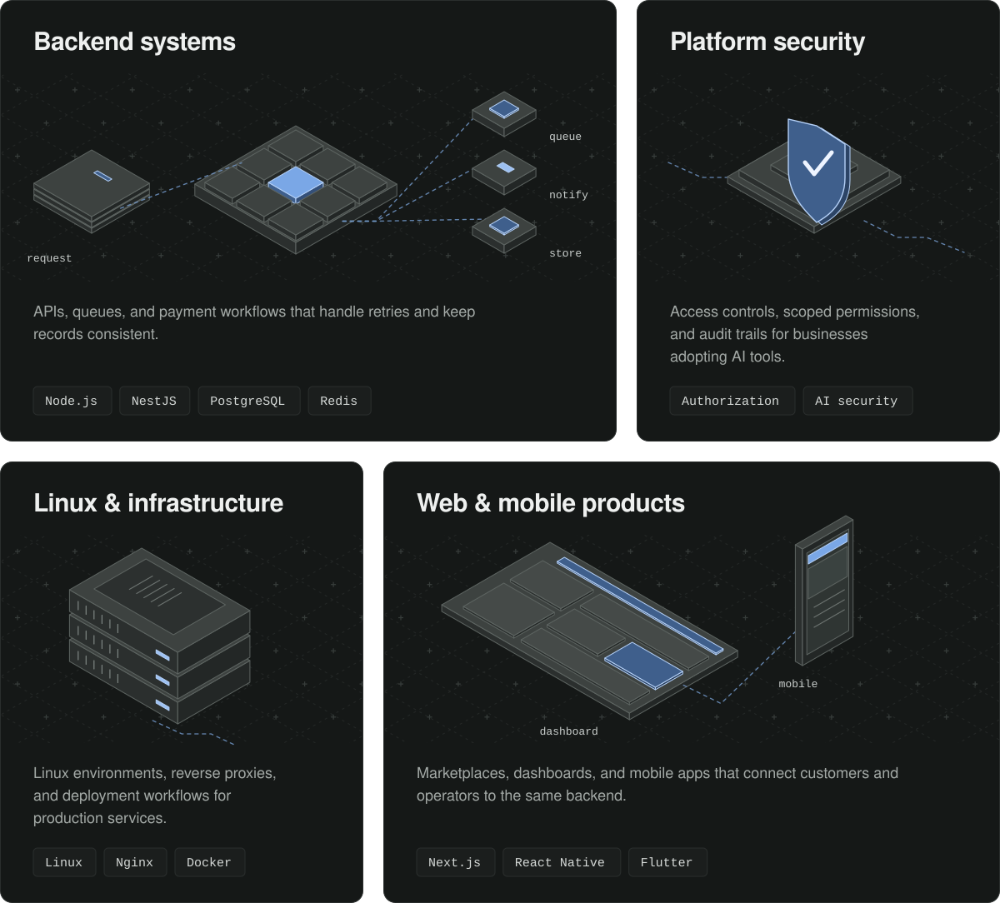

  
  
  
  

Software engineer with 4+ years shipping production web and mobile products — mostly on the backend: APIs, payments, queues, and the infrastructure underneath. Open to remote roles and consulting.

## Engineering focus

## Selected work

| Project | What it is | Stack |
| --- | --- | --- |
| [**SafeNaija**](https://safenaija.com) | Emergency alerts to trusted contacts with GPS, SMS fallback and push | React Native · Node.js · MySQL |
| [**Rekrutklin**](https://rekrutklin.com) | Clinical trial recruitment and participant management | Expo · Node.js · PostgreSQL |
| [**TRAK**](https://app.trak.com.ng) | Project, workforce and document management for teams | Next.js · Express · Redis |
| **SabiIQ** | AI-powered exam prep with simulations and tutoring *(in progress)* | NestJS · PostgreSQL · Prisma |
| [**Kodelift**](https://kodelift.ng) | Mentorship programme teaching young people to build software | Next.js · TypeScript |

More on [devquat.xyz](https://devquat.xyz).

## Toolbox

 

